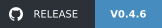

  

<h1 align="center">Godot Wingman</h1>

  
  
  
  
  

  
  
  

  
  
  
  
  

  <a href="https://godot-wingman.pages.dev"><b>Website</b></a> ·
  <a href="README.md#quick-start"><b>Quick start</b></a> ·
  <a href="docs/INSTALL.md"><b>Installation guide</b></a> ·
  <a href="CHANGELOG.md"><b>Changelog</b></a>

  

  <a href="README.md">English</a> · <a href="README.tr.md">Türkçe</a> · <a href="README.es.md">Español</a> · <a href="README.pt-BR.md">Português (Brasil)</a> · <a href="README.de.md">Deutsch</a> · <a href="README.fr.md">Français</a> · <a href="README.ru.md">Русский</a> · <a href="README.zh-CN.md">简体中文</a> · <a href="README.ja.md">日本語</a> · <a href="README.ko.md">한국어</a>

**Ein lokaler MCP-Server, mit dem jeder KI-Assistent den Godot-Editor so benutzen kann, wie ein Mensch es tut.** Er kann den Editor sehen, Szenen aufbauen, Eigenschaften im Inspector ändern, Skripte schreiben und prüfen, das Spiel mit echten Eingaben spielen und Fehler lesen und beheben.

> **Inoffiziell.** Godot Wingman ist ein Community-Projekt. Es steht in keiner Verbindung zur Godot Foundation oder zum Godot-Engine-Projekt und wird von ihnen nicht unterstützt. „Godot“ ist eine Marke der Godot Foundation.

> **Status: frühe Entwicklung (0.x).** Vor Version 1.0 muss das Projekt stabil werden und von echten Nutzern gut getestet sein.

Details stehen im [englischen README](README.md) und im [Installationsleitfaden](docs/INSTALL.md).

  

## Kurz gesagt

- Änderungen passieren im geöffneten Editor und landen in Godots Rückgängig-Verlauf. Du kannst sie mit Strg+Z zurücknehmen.
- Die KI sieht den Editor, die 2D/3D-Ansicht und das laufende Spiel.
- Sie spielt das Spiel mit echten Eingaben: Tasten gedrückt halten, Timing, Bild für Bild weiterlaufen lassen und „warten, bis etwas eintritt“.
- Sie liest die Dokumentation der installierten Godot-Version und die Klassen deiner GDExtensions.
- Das Godot-Wingman-Panel unten im Editor listet jede Änderung der KI auf. Es kann Skripte, Szenen, Ressourcen und Einstellungen auf den Stand vor einem beliebigen Schritt zurücksetzen.
- Wenn du Strg+Z drückst, selbst etwas änderst oder im Panel zurückgehst, erfährt die KI das mit ihrem nächsten Schritt. Sie arbeitet dann nicht weiter an einem Zustand, den es nicht mehr gibt.
- KIs, die im selben Editor arbeiten (zum Beispiel Claude Code und Cursor), können einander sagen, was sie ändern wollen. Im Chat-Tab des Panels schreibst du einer KI oder allen, hängst Dateien, Nodes und Screenshots an und liest ihre formatierten Antworten. Eine KI, die du bittest, dir dort zuzuhören, bekommt deine Nachrichten sofort.
- Die Werkzeuge sind in Gruppen geordnet: 121 Werkzeuge in 20 Gruppen (Szene, Inspector, Skript, Animation, Tilemap, Oberfläche, 3D, Shader, Audio, Export, Spiel spielen ...). Die KI schaltet nur die Gruppen ein, die sie braucht.

## Berechtigungsmodi

| Modus | Was die KI darf |
|---|---|
| `full` (Standard) | Verwendet alle aktivierten Werkzeuge. |
| `confirm` | Die KI darf frei lesen. Vor jeder Änderung zeigt Godot, was die KI tun will (bei GDScript den ganzen Code), und du klickst auf „Erlauben“ oder „Ablehnen“. |
| `read-only` | Die KI darf nur ansehen. Werkzeuge, die Dateien ändern, GDScript ausführen, das Spiel starten oder Eingaben senden, werden ausgeblendet. |

Den Modus legst du beim Hinzufügen von Godot Wingman zu deinem KI-Client fest (`--mode`) oder im Godot-Wingman-Panel in Godot. Dort hat jede verbundene KI ihren eigenen Modus, zum Beispiel Nur-Lesen für eine KI, die plant, und vollen Zugriff für eine, die programmiert. Wenn beide unterschiedlich sind, gilt der strengere. Im Bestätigungsfenster kannst du ein Werkzeug für den Rest der Sitzung erlauben. So fragt eine lange Reihe ähnlicher Änderungen nicht jedes Mal nach.

## Sprachen

- **GDScript**: vollständig unterstützt.
- **C#**: Wenn das Projekt mit der .NET-Version von Godot geöffnet wird, kann die KI C#-Skripte schreiben und bearbeiten.
- **GDExtension (Rust, C++)**: Die KI sieht die Klassen, die deine Erweiterungen hinzufügen, mit ihren Eigenschaften, Methoden und Signalen.

Die wichtigsten End-to-End-Tests laufen mit einem GDScript-Projekt. Jede Nacht und vor jedem Release werden zusätzlich getestet: ein C#-Projekt (Godot .NET 4.7.2: ein C#-Skript wird geschrieben, mit `dotnet build` gebaut, an einen Node angehängt und im Spiel ausgeführt) und eine mit godot-rust in Rust geschriebene GDExtension (ihre Klasse wird dokumentiert, in eine Szene eingefügt, bearbeitet und im Spiel aufgerufen).

## Datenschutz

Godot Wingman läuft auf deinem Computer und sendet nichts über dich oder dein Projekt irgendwohin: keine Konten, keine Cloud, **keine Telemetrie**.

Um dich über neue Versionen zu informieren, lädt es höchstens einmal am Tag die Liste der Godot-Wingman-Releases von GitHub herunter. Das ist wie das Öffnen der Releases-Seite im Browser; dabei wird nichts gesendet. Abschalten mit `--no-update-check`. Wenn eine neue Version erscheint, sagt dir die KI Bescheid und installiert sie auf Wunsch. Oder du führst `godot-wingman update` aus.

Dein KI-Client ist eine andere Sache: Alles, was die KI über Godot Wingman liest (Code, Szenen, Screenshots, Fehler), geht an das KI-Modell, das du verwendest, und gilt nach den Regeln dieses Anbieters. Damit alles auf deinem Computer bleibt, muss auch das Modell auf deinem eigenen Computer laufen.

Godot 4.5 oder neuer ist nötig. Jede Änderung wird mit Godot 4.5.2, 4.6.3 und 4.7.2 getestet.

## Lizenz

[GNU AGPL-3.0](LICENSE). Du darfst Godot Wingman verwenden, untersuchen, ändern und weitergeben. Wenn du eine geänderte Version verbreitest oder sie anderen über ein Netzwerk anbietest, musst du ihren Quellcode unter derselben Lizenz teilen.

**Spiele, die du mit Godot Wingman machst, sind von dieser Lizenz nicht betroffen.** Das Addon läuft nur im Editor und ist nicht im exportierten Spiel enthalten. Du kannst dein Spiel unter der Lizenz deiner Wahl verkaufen.

- **Steht der KI-geschriebene Code unter der AGPL?** Nein. Die AGPL gilt nur für die Dateien von Godot Wingman selbst (Server und Ordner `addons/godot_wingman`). Was du und die KI in deinem Projekt erstellt, gehört dir.
- **Darf ich es in einer Firma benutzen?** Ja. Die Nutzung zwingt dich nicht, irgendetwas zu teilen.
- **Wann muss ich den Quellcode teilen?** Nur wenn du Godot Wingman selbst weitergibst (verändert oder unverändert) oder eine veränderte Version anderen über ein Netzwerk zur Nutzung überlässt. Dann teilst du den Quellcode dieser Version unter der AGPL-3.0.

Dies ist eine Zusammenfassung, keine Rechtsberatung. Maßgeblich ist der [Lizenztext](LICENSE).
