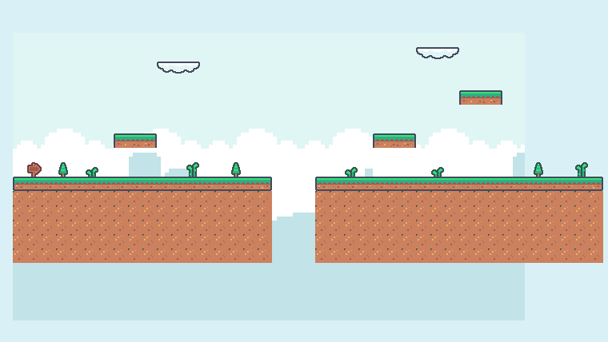
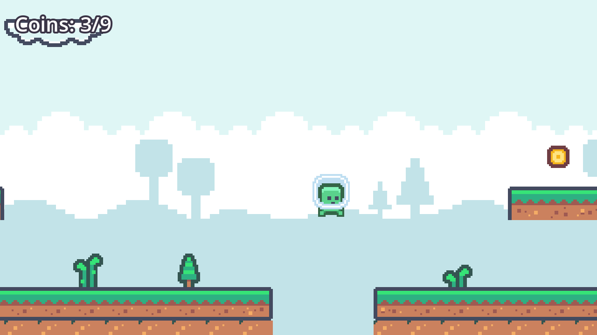
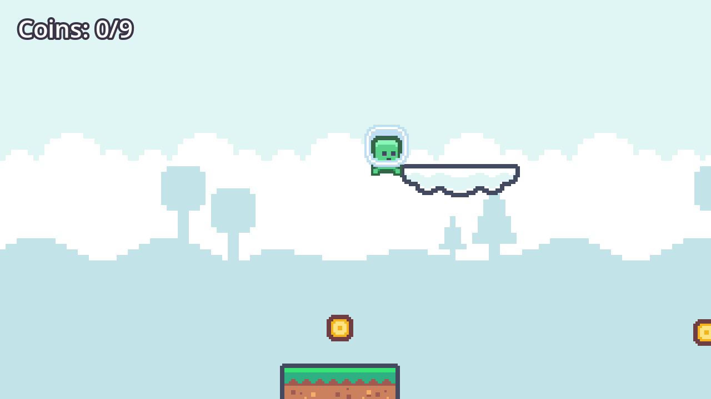

<p align="center">
  
</p>

<h1 align="center">Godot Wingman</h1>

<p align="center">
  <b>Let your AI app use the Godot editor.</b><br>
  It builds scenes, writes scripts, plays the game with real input, reads the errors and fixes them.
</p>

<p align="center">
  
  
  
  
  
  
</p>

<p align="center">
  <a href="https://github.com/Godot-Wingman/godot-wingman/releases"></a>
  <a href="https://github.com/Godot-Wingman/godot-wingman/releases"></a>
  <a href="https://github.com/Godot-Wingman/godot-wingman/actions/workflows/ci.yml"></a>
  <a href="https://github.com/Godot-Wingman/godot-wingman/commits/main"></a>
  <a href="https://github.com/Godot-Wingman/godot-wingman/stargazers"></a>
  <a href="https://github.com/Godot-Wingman/godot-wingman/forks"></a>
  <a href="LICENSE"></a>
  
</p>

<p align="center">
  <a href="https://godot-wingman.pages.dev"><b>Website</b></a> ·
  <a href="#quick-start"><b>Quick start</b></a> ·
  <a href="docs/INSTALL.md"><b>Installation guide</b></a> ·
  <a href="CHANGELOG.md"><b>Changelog</b></a>
</p>

<p align="center">
  
</p>

<p align="center"><sub>
  <a href="README.tr.md">Türkçe</a> · <a href="README.es.md">Español</a> · <a href="README.pt-BR.md">Português (Brasil)</a> · <a href="README.de.md">Deutsch</a> · <a href="README.fr.md">Français</a> · <a href="README.ru.md">Русский</a> · <a href="README.zh-CN.md">简体中文</a> · <a href="README.ja.md">日本語</a> · <a href="README.ko.md">한국어</a>
</sub></p>

**Godot Wingman is a local MCP server that lets any AI assistant use the Godot editor the way a person does.** It works with Claude Code, Claude Desktop, Codex, Cursor, Gemini CLI, Windsurf, GitHub Copilot in VS Code and other MCP clients.

> [!NOTE]
> **Unofficial project.** Godot Wingman is a community project. It is not made by, affiliated with or endorsed by the Godot Foundation or the Godot Engine project. "Godot" is a trademark of the Godot Foundation.

> [!WARNING]
> **Early development (0.x).** Things change quickly and may break. Version 1.0 will only come once the project is stable and well tested by real users.

## See it work

A real session: three requests, and screenshots taken through Godot Wingman along the way.

| 1. *"Build a level with the Kenney tiles in art/."* | 2. *"Add a player that runs and jumps, coins and a score. Then play it."* | 3. *"Let the player jump twice in the air."* |
|---|---|---|
|  |  |  |

<p align="center">
  
</p>

<p align="center"><sub>The finished game, played through Godot Wingman frame by frame (step_frames, input events, take_game_screenshot).<br>Game art: <a href="https://kenney.nl/assets/pixel-platformer">Pixel Platformer</a> by Kenney (CC0).</sub></p>

## What it does

Godot Wingman works inside the open Godot editor, through an addon:

- **Live changes with undo.** Scene and inspector changes happen in the open editor and go through Godot's undo history, so you can press Ctrl+Z.
- **Seeing.** Screenshots of the editor window, the 2D/3D viewport and the running game, with camera control.
- **Playing.** Real input events: holding keys, timing, sequences, frame stepping and "wait until a condition is true".
- **Godot knowledge.** The class reference of the Godot version you have installed, plus the classes of your GDExtensions and scripts.
- **Fallback.** When no tool fits, the AI can run GDScript inside the editor.
- **You stay in control.** The Godot Wingman panel at the bottom of the editor lists every change the AI made and can put scripts, scenes, resources and settings back to how they were before any of them.
- **You and the AI stay in step.** When you press Ctrl+Z, change something by hand or go back in the panel, the AI is told with its next step, so it does not keep working on a state that is gone.
- **Several AIs, one editor.** AIs working in the same editor (for example Claude Code and Cursor) can tell each other what they are about to change, and you can write to all of them from the panel.
- **Small context.** 121 tools in 20 toolsets: scene, inspector, script, project settings, signals, resources, file system, viewport, playing the game, input, live game inspection, debugging, animation, tile maps, UI, 3D, shaders, audio and export. The AI turns on only the groups it needs. See the [changelog](CHANGELOG.md).

## Permission modes

| Mode | What the AI may do |
|---|---|
| `full` (default) | Use every enabled tool. |
| `confirm` | Look freely. Before every change, Godot shows what the AI wants to do (for GDScript, the whole code) and you click Allow or Deny. |
| `read-only` | Only look. Tools that change files, run GDScript, start the game or send input are hidden. |

Set the mode when you add Godot Wingman to your AI client (`--mode`, see the [installation guide](docs/INSTALL.md)), or in Godot in the Godot Wingman panel. If the two differ, the stricter one applies. In the dialog you can also allow one tool for the rest of the session, so a long series of similar changes does not ask every time.

## Languages

- **GDScript**: fully supported.
- **C#**: the AI can write and edit C# scripts when the project is opened with the .NET build of Godot.
- **GDExtension (Rust, C++)**: the AI sees the classes your extensions add, with their properties, methods and signals.

The main end-to-end tests use a GDScript project. Every night, and before each release, separate tests also check a C# project (Godot .NET 4.7.2: a C# script is written, built with `dotnet build`, attached and run in the game) and a GDExtension written in Rust with godot-rust (its class is documented, added to a scene, edited and called in the game).

## Privacy

Godot Wingman runs on your computer and sends nothing about you or your project anywhere: no accounts, no cloud, **no telemetry**.

To tell you about new versions, it downloads the list of Godot Wingman releases from GitHub at most once a day, like opening the releases page in a browser. Nothing is sent with it. Turn it off with `--no-update-check`.

Your AI client is a different matter: what the AI reads through Godot Wingman (code, scenes, screenshots, errors) goes to the AI model you use, under that provider's rules. Only a model running on your own computer keeps everything local.

## Quick start

1. Install it with one command. Windows (PowerShell):
   ```powershell
   irm https://raw.githubusercontent.com/Godot-Wingman/godot-wingman/main/install/install.ps1 | iex
   ```
   macOS and Linux:
   ```sh
   curl -fsSL https://raw.githubusercontent.com/Godot-Wingman/godot-wingman/main/install/install.sh | sh
   ```
   It downloads the newest release, checks it, and adds it to the AI apps it finds (Codex, Claude Desktop, Claude Code, Cursor, Gemini CLI, Windsurf). Installing by hand and other clients: **[installation guide](docs/INSTALL.md)**.
2. Restart your AI app and ask: *"Create a new Godot game in C:/games/my-game"*, or *"Open my Godot project at C:/games/my-game and show me the main scene."*

The AI creates or opens the project, installs the addon, opens the editor and connects. Requires **Godot 4.5 or newer**. Every change is tested with Godot 4.5.2, 4.6.3 and 4.7.2.

**Updating:** when a new version is out, the AI tells you and installs it if you agree. You can also run `godot-wingman update`.

## How it works

```
AI client ──stdio──▶ godot-wingman (MCP server)
                          │  WebSocket on 127.0.0.1, secret token
                          ▼
                    Godot editor + Godot Wingman addon
                          │  Godot's own debugger channel
                          ▼
                    Your running game (only when started from the editor)
```

The addon only runs in the editor. It is never part of an exported game.

## Development

Requires [Bun](https://bun.sh) and Godot.

```
bun install
bun run test          # unit tests + end-to-end tests against a real headless Godot
bun run test:unit     # only the unit tests, no Godot needed
GODOT_WINGMAN_WINDOWED=1 bun test tests/windowed   # with a real editor window
bun run lint          # Biome
bun run typecheck
bun run build         # standalone executables for every platform in dist/
bun run start         # run the server from source
```

Read [CONTRIBUTING.md](CONTRIBUTING.md) before opening a pull request.

## License

[GNU AGPL-3.0](LICENSE). You may use, study, change and share Godot Wingman. If you distribute a modified version, or offer it to others over a network, you must share its source under the same license.

**Games you make with Godot Wingman are not affected.** The addon is an editor tool and is not included in exported games, so your game can use any license and be sold freely.

<details>
<summary><b>License questions</b></summary>

- **Can I sell a game I made with Godot Wingman?** Yes. Exported games do not contain the addon (a test checks this on every change), and your game's code and assets are yours.
- **Is the code the AI writes for me under the AGPL?** No. The AGPL covers Godot Wingman's own files: the server and the `addons/godot_wingman` folder. What you and the AI create in your project is yours.
- **Can I use it at work, in a company?** Yes. Using Godot Wingman does not oblige you to share anything.
- **May the `addons/godot_wingman` folder stay in my game's repository?** Yes. It keeps its own license; a copy of it is in that folder.
- **When do I have to share source code?** Only when you give Godot Wingman itself to others, changed or not, or let others use a changed version over a network. Then you share that version's source under the AGPL-3.0.

This is a summary, not legal advice; the [license text](LICENSE) is what counts.

</details>
