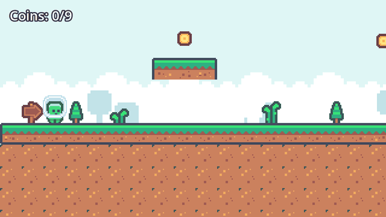

  

<h1 align="center">Godot Wingman</h1>

  
  
  
  
  
  

  
  
  
  
  
  
  
  

  <a href="https://godot-wingman.pages.dev"><b>Website</b></a> ·
  <a href="README.md#quick-start"><b>Quick start</b></a> ·
  <a href="docs/INSTALL.md"><b>Installation guide</b></a> ·
  <a href="CHANGELOG.md"><b>Changelog</b></a>

  

  <a href="README.md">English</a> · <a href="README.tr.md">Türkçe</a> · <a href="README.es.md">Español</a> · <a href="README.pt-BR.md">Português (Brasil)</a> · <a href="README.de.md">Deutsch</a> · <a href="README.fr.md">Français</a> · <a href="README.ru.md">Русский</a> · <a href="README.zh-CN.md">简体中文</a> · <a href="README.ja.md">日本語</a> · <a href="README.ko.md">한국어</a>

**MCP-сервер, который работает на вашем компьютере и позволяет любому ИИ-ассистенту пользоваться редактором Godot так же, как это делает человек.** Он может видеть редактор, собирать сцены, менять свойства в инспекторе, писать и проверять скрипты, запускать игру и играть в неё реальными нажатиями клавиш, читать ошибки и исправлять их.

> **Не официальный проект.** Godot Wingman — проект сообщества. Он не связан с Godot Foundation и с проектом Godot Engine. «Godot» — торговая марка Godot Foundation.

> **Статус: ранняя разработка (0.x).** Версия 1.0 выйдет только тогда, когда проект станет стабильным и его проверят реальные пользователи.

Подробнее см. [README на английском](README.md) и [руководство по установке](docs/INSTALL.md).

  

## Коротко

- Изменения вносятся в открытом редакторе и попадают в историю отмены Godot, поэтому их можно отменить через Ctrl+Z.
- ИИ видит редактор, 2D- и 3D-виды и запущенную игру.
- Игра управляется реальным вводом: удержание клавиш, тайминг, покадровый запуск, ожидание «пока не выполнится условие».
- Godot Wingman читает встроенную документацию установленной версии Godot и классы ваших GDExtension.
- Панель Godot Wingman внизу редактора показывает каждое изменение, которое сделал ИИ. Она может вернуть скрипты, сцены, ресурсы и настройки к тому виду, который у них был до выбранного шага.
- Когда вы нажимаете Ctrl+Z, меняете что-то вручную или откатываетесь через панель, ИИ узнаёт об этом со своим следующим шагом и не продолжает работать с состоянием, которого уже нет.
- ИИ, работающие в одном редакторе (например, Claude Code и Cursor), могут сообщать друг другу, что они собираются изменить. Вы также можете написать всем из панели.
- Инструменты сгруппированы: 121 инструментов в 20 группах (сцена, инспектор, скрипт, анимация, tilemap, интерфейс, 3D, шейдеры, звук, экспорт, запуск игры...). ИИ включает только те группы, которые ему нужны.

## Режимы доступа

| Режим | Что может делать ИИ |
|---|---|
| `full` (по умолчанию) | Использует все включённые инструменты. |
| `confirm` | Свободно смотрит. Перед каждым изменением Godot показывает, что хочет сделать ИИ (для GDScript — весь код), и вы выбираете «Разрешить» или «Отклонить». |
| `read-only` | Только смотрит. Инструменты, которые меняют файлы, запускают GDScript, запускают игру или отправляют ввод, скрыты. |

Режим можно задать при добавлении Godot Wingman в ИИ-клиент (`--mode`) или в Godot, на панели Godot Wingman. Если настройки различаются, действует более строгая. В окне подтверждения можно также разрешить инструмент до конца сессии, чтобы длинная серия похожих изменений не спрашивала подтверждение каждый раз.

## Языки

- **GDScript**: полная поддержка.
- **C#**: ИИ может писать и редактировать C#-скрипты, если проект открыт в .NET-версии Godot.
- **GDExtension (Rust, C++)**: ИИ видит классы, которые добавляют ваши расширения, вместе с их свойствами, методами и сигналами.

Основные сквозные тесты используют проект на GDScript. Каждую ночь и перед каждым выпуском отдельные тесты также проверяют проект на C# (Godot .NET 4.7.2: C#-скрипт пишется, собирается через `dotnet build`, прикрепляется к узлу и запускается в игре) и GDExtension на Rust с godot-rust (её класс документируется, добавляется в сцену, изменяется и вызывается в игре).

## Конфиденциальность

Godot Wingman работает на вашем компьютере и ничего о вас или вашем проекте никуда не отправляет: нет аккаунтов, нет облака, **нет сбора данных**.

Чтобы сообщать о новых версиях, он не чаще одного раза в день скачивает список выпусков Godot Wingman с GitHub. Это похоже на открытие страницы выпусков в браузере. Ничего при этом не отправляется. Проверку можно отключить параметром `--no-update-check`. Когда выходит новая версия, ИИ сообщает вам об этом и, если вы согласны, устанавливает её. Также можно запустить `godot-wingman update`.

ИИ-клиент — отдельный вопрос: то, что ИИ читает через Godot Wingman (код, сцены, скриншоты, ошибки), уходит к используемой вами ИИ-модели по правилам её провайдера. Только модель, которая работает на вашем собственном компьютере, оставляет всё локально.

Требуется Godot 4.5 или новее. Каждое изменение проверяется на Godot 4.5.2, 4.6.3 и 4.7.2.

## Лицензия

[GNU AGPL-3.0](LICENSE). Вы можете использовать, изучать, изменять и распространять Godot Wingman. Если вы распространяете изменённую версию или предоставляете её другим через сеть, вы обязаны делиться её исходным кодом по той же лицензии.

**Игры, которые вы делаете с Godot Wingman, эта лицензия не затрагивает.** Аддон — инструмент редактора, он не входит в экспортированные игры. Поэтому ваша игра может иметь любую лицензию и свободно продаваться.

- **Код, который ИИ пишет для меня, подпадает под AGPL?** Нет. AGPL относится только к собственным файлам Godot Wingman: серверу и папке `addons/godot_wingman`. То, что вы и ИИ создаёте в своём проекте, принадлежит вам.
- **Можно ли использовать его на работе, в компании?** Да. Использование Godot Wingman не обязывает вас ничем делиться.
- **Когда нужно делиться исходным кодом?** Только тогда, когда вы передаёте сам Godot Wingman другим, изменённый или нет, или позволяете другим использовать изменённую версию через сеть.

Это краткое изложение, а не юридическая консультация. Имеет силу [текст лицензии](LICENSE).
