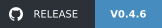

  

<h1 align="center">Godot Wingman</h1>

  
  
  
  
  

  
  
  

  
  
  
  
  

  <a href="https://godot-wingman.pages.dev"><b>Website</b></a> ·
  <a href="README.md#quick-start"><b>Quick start</b></a> ·
  <a href="docs/INSTALL.md"><b>Installation guide</b></a> ·
  <a href="CHANGELOG.md"><b>Changelog</b></a>

  

  <a href="README.md">English</a> · <a href="README.tr.md">Türkçe</a> · <a href="README.es.md">Español</a> · <a href="README.pt-BR.md">Português (Brasil)</a> · <a href="README.de.md">Deutsch</a> · <a href="README.fr.md">Français</a> · <a href="README.ru.md">Русский</a> · <a href="README.zh-CN.md">简体中文</a> · <a href="README.ja.md">日本語</a> · <a href="README.ko.md">한국어</a>

**Herhangi bir yapay zekâ asistanının Godot editörünü bir insan gibi kullanmasını sağlayan, bilgisayarında çalışan bir MCP sunucusu.** Editörü görebilir, sahne kurabilir, inspector'dan özellik değiştirebilir, script yazıp kontrol edebilir, oyunu gerçek tuş girdileriyle oynayabilir, hataları okuyup düzeltebilir.

> **Resmi değildir.** Godot Wingman bir topluluk projesidir. Godot Foundation veya Godot Engine projesiyle bir bağı yoktur. "Godot", Godot Foundation'ın markasıdır.

> **Durum: erken geliştirme (0.x).** Kararlı hale gelip gerçek kullanıcılarla test edilmeden 1.0 çıkmayacak.

Ayrıntılar için [İngilizce README](README.md) ve [kurulum rehberi](docs/INSTALL.md).

  

## Kısaca

- Değişiklikler açık editörde yapılır ve Godot'nun geri alma geçmişine girer, Ctrl+Z ile geri alınır.
- AI editörü, 2D/3D görünümü ve çalışan oyunu görür.
- Oyunu gerçek input ile oynar: tuşu basılı tutma, zamanlama, kare kare ilerletme, "şu olana kadar bekle".
- Kurulu Godot sürümünün kendi dokümantasyonunu ve GDExtension sınıflarını okur.
- Editörün altındaki Godot Wingman paneli AI'ın yaptığı her değişikliği listeler; script, sahne, kaynak ve ayarları istediğin adımdan önceki haline döndürebilir.
- Sen Ctrl+Z'ye bastığında, elle bir şey değiştirdiğinde ya da panelden geri döndüğünde AI bunu bir sonraki adımında öğrenir; artık var olmayan bir hal üzerinde çalışmaya devam etmez.
- Aynı editörde çalışan AI'lar (örneğin Claude Code ve Cursor) ne değiştireceklerini birbirlerine söyleyebilir; sen de panelden hepsine yazabilirsin.
- Araçlar gruplar halindedir (20 grupta 121 araç: sahne, inspector, script, animasyon, tilemap, arayüz, 3D, shader, ses, export, oyunu oynama...). AI sadece ihtiyacı olan grupları açar.

## İzin modları

| Mod | AI ne yapabilir |
|---|---|
| `full` (varsayılan) | Açık olan bütün araçları kullanır. |
| `confirm` | Serbestçe bakar. Her değişiklikten önce Godot, AI'ın ne yapmak istediğini gösterir (GDScript ise kodun tamamını), sen İzin ver ya da Reddet dersin. |
| `read-only` | Sadece bakar. Dosya değiştiren, GDScript çalıştıran, oyunu başlatan veya input gönderen araçlar gizlenir. |

Modu AI istemcisine eklerken (`--mode`) ya da Godot'da Godot Wingman panelinden seçebilirsin. İkisi farklıysa sıkı olan geçerlidir. Onay penceresinde bir aracı oturumun sonuna kadar serbest bırakabilirsin; böylece art arda gelen benzer değişiklikler her seferinde sormaz.

## Diller

- **GDScript**: tam destek.
- **C#**: Proje Godot'nun .NET sürümüyle açıldığında AI C# script yazıp düzenleyebilir.
- **GDExtension (Rust, C++)**: AI, eklentilerinin eklediği sınıfları, özellikleriyle, metotlarıyla ve sinyalleriyle görür.

Ana uçtan uca testler bir GDScript projesiyle yapılıyor. Her gece ve her sürümden önce ayrıca bir C# projesi (Godot .NET 4.7.2: C# script yazılır, `dotnet build` ile derlenir, node'a eklenir, oyunda çalışır) ve godot-rust ile Rust'ta yazılmış bir GDExtension (sınıfı dokümante edilir, sahneye eklenir, düzenlenir, oyunda çağrılır) test edilir.

## Gizlilik

Godot Wingman senin bilgisayarında çalışır ve senin ya da projen hakkında hiçbir yere veri göndermez: hesap yok, bulut yok, **veri toplama yok**.

Yeni sürümleri haber vermek için günde en fazla bir kez GitHub'dan Godot Wingman sürüm listesini indirir; tarayıcıda sürümler sayfasını açmak gibidir, hiçbir şey gönderilmez. `--no-update-check` ile kapatılır. Yeni sürüm çıkınca AI sana söyler, istersen kurar; ya da `godot-wingman update` çalıştırırsın.

AI istemcin ise ayrı bir konu: AI'ın Godot Wingman üzerinden okuduğu her şey (kod, sahneler, ekran görüntüleri, hatalar) kullandığın AI modeline, o sağlayıcının kurallarıyla gider. Her şeyin bilgisayarında kalması için modelin de kendi bilgisayarında çalışması gerekir.

Godot 4.5 veya üstü gerekir. Her değişiklik Godot 4.5.2, 4.6.3 ve 4.7.2 ile test edilir.

## Lisans

[GNU AGPL-3.0](LICENSE). Kullanabilir, inceleyebilir, değiştirebilir, paylaşabilirsin. Değiştirilmiş bir sürümü dağıtır veya internet üzerinden sunarsan kaynak kodunu aynı lisansla paylaşmak zorundasın.

**Godot Wingman ile yaptığın oyunlar bu lisanstan etkilenmez.** Addon sadece editörde çalışır, export edilen oyuna girmez; oyununu istediğin lisansla satabilirsin.

- **AI'ın yazdığı kod AGPL mi olur?** Hayır. AGPL sadece Godot Wingman'in kendi dosyalarını (sunucu ve `addons/godot_wingman` klasörü) kapsar. Projende yaptıkların senindir.
- **İşte, bir şirkette kullanabilir miyim?** Evet. Kullanmak seni hiçbir şeyi paylaşmaya zorlamaz.
- **Ne zaman kaynak kodu paylaşmam gerekir?** Sadece Godot Wingman'in kendisini (değiştirilmiş ya da değil) başkalarına verirsen veya değiştirilmiş bir sürümü internet üzerinden kullandırırsan.

Bu bir özettir, hukuki tavsiye değildir; geçerli olan [lisans metnidir](LICENSE).
