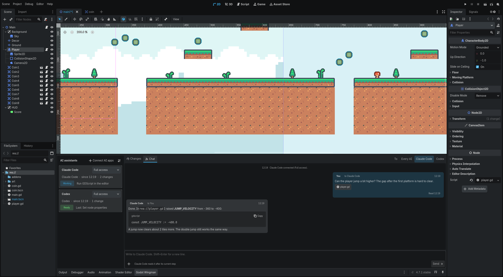

  

<h1 align="center">Godot Wingman</h1>

  
  
  
  
  

  
  
  
  
  

  
  
  
  
  

  <a href="https://godot-wingman.pages.dev"><b>Website</b></a> ·
  <a href="README.md#quick-start"><b>Quick start</b></a> ·
  <a href="docs/INSTALL.md"><b>Installation guide</b></a> ·
  <a href="CHANGELOG.md"><b>Changelog</b></a>

  

  <a href="README.md">English</a> · <a href="README.tr.md">Türkçe</a> · <a href="README.es.md">Español</a> · <a href="README.pt-BR.md">Português (Brasil)</a> · <a href="README.de.md">Deutsch</a> · <a href="README.fr.md">Français</a> · <a href="README.ru.md">Русский</a> · <a href="README.zh-CN.md">简体中文</a> · <a href="README.ja.md">日本語</a> · <a href="README.ko.md">한국어</a>

**一个在你电脑上运行的 MCP 服务器，让任何 AI 助手都能像人一样使用 Godot 编辑器。** 它可以查看编辑器、搭建场景、在检查器中修改属性、编写并检查脚本、用真实的按键输入来玩游戏，并读取错误信息后进行修复。

> **非官方项目。** Godot Wingman 是社区项目。它与 Godot Foundation 或 Godot Engine 项目没有任何关联。“Godot”是 Godot Foundation 的商标。

> **状态：早期开发（0.x）。** 在项目稳定并经过真实用户测试之前，不会发布 1.0 版本。

更多详情请参阅 [英文 README](README.md) 和 [安装指南](docs/INSTALL.md)。

  

## 简要说明

- 更改在打开的编辑器中进行，并记录在 Godot 的撤销历史中，可以用 Ctrl+Z 撤销。
- AI 可以看到编辑器、2D/3D 视图和正在运行的游戏。
- AI 通过真实输入来玩游戏：按住按键、计时、逐帧推进，以及“等到某个条件成立”。
- 它会读取已安装的 Godot 版本自带的文档，以及 GDExtension 的类。
- 编辑器底部的 Godot Wingman 面板会列出 AI 做出的每一项更改，并可以把脚本、场景、资源和设置恢复到你所选步骤之前的状态。
- 当你按下 Ctrl+Z、手动修改内容或在面板中回退时，AI 会在下一步得知这一情况，不会继续在已经不存在的状态上工作。
- 在同一编辑器中工作的 AI（例如 Claude Code 和 Cursor）可以互相告知它们将要做的修改；你也可以在面板中向所有 AI 发送消息。
- 工具按组划分（20 组共 121 个工具：场景、检查器、脚本、动画、瓦片地图、界面、3D、着色器、音频、导出、运行游戏……）。AI 只开启它需要的工具组。

## 权限模式

| 模式 | AI 可以做什么 |
|---|---|
| `full`（默认） | 使用所有已开启的工具。 |
| `confirm` | 可以自由查看。每次修改前，Godot 都会显示 AI 想做什么（如果是 GDScript，则显示完整代码），由你点击“允许”或“拒绝”。 |
| `read-only` | 只能查看。会修改文件、运行 GDScript、启动游戏或发送输入的工具会被隐藏。 |

你可以在把 Godot Wingman 添加到 AI 客户端时设置模式（`--mode`），也可以在 Godot 的 Godot Wingman 面板中选择。两者不一致时，以更严格的那个为准。在确认窗口中，你还可以把某个工具放行到本次会话结束，这样一连串类似的修改就不会每次都询问。

## 语言

- **GDScript**：完整支持。
- **C#**：当项目使用 Godot 的 .NET 版本打开时，AI 可以编写和编辑 C# 脚本。
- **GDExtension（Rust、C++）**：AI 可以看到你的扩展添加的类，以及它们的属性、方法和信号。

主要的端到端测试使用 GDScript 项目。每晚以及每次发布前，还会分别测试一个 C# 项目（Godot .NET 4.7.2：编写 C# 脚本，使用 `dotnet build` 编译，挂载到节点上，并在游戏中运行），以及一个用 godot-rust 在 Rust 中编写的 GDExtension（记录其类、添加到场景中、编辑，并在游戏中调用）。

## 隐私

Godot Wingman 在你的电脑上运行，不会把任何关于你或你项目的数据发送到任何地方：没有账户，没有云端，**不进行数据收集**。

为了通知新版本，它每天最多一次从 GitHub 下载 Godot Wingman 版本列表。这类似于在浏览器中打开版本页面，不会发送任何内容。可以用 `--no-update-check` 关闭。发布新版本时，AI 会告诉你，如果你同意，它会安装；你也可以运行 `godot-wingman update`。

AI 客户端则是另外一回事：AI 通过 Godot Wingman 读取的所有内容（代码、场景、截图、错误信息），都会按照该服务提供方的规则发送给你所使用的 AI 模型。要让所有内容都留在你的电脑上，模型也必须在你自己的电脑上运行。

需要 Godot 4.5 或更高版本。每项更改都会在 Godot 4.5.2、4.6.3 和 4.7.2 上测试。

## 许可证

[GNU AGPL-3.0](LICENSE)。你可以使用、研究、修改和分享 Godot Wingman。如果你分发修改后的版本，或通过网络向他人提供，就必须以相同的许可证公开其源代码。

**用 Godot Wingman 制作的游戏不受此许可证影响。** 插件（addon）只在编辑器中运行，不会包含在导出的游戏中；你的游戏可以使用任何许可证，也可以自由出售。

- **AI 为我写的代码是 AGPL 的吗？** 不是。AGPL 只涵盖 Godot Wingman 自身的文件（服务器和 `addons/godot_wingman` 文件夹）。你和 AI 在项目中创建的内容归你所有。
- **我可以在公司里使用吗？** 可以。使用 Godot Wingman 不会强制你分享任何东西。
- **什么时候需要公开源代码？** 只有当你把 Godot Wingman 本身（无论是否修改）交给别人，或者通过网络让别人使用修改后的版本时。

这只是摘要，不是法律建议；以[许可证全文](LICENSE)为准。
